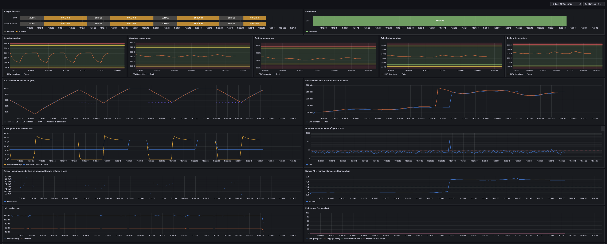
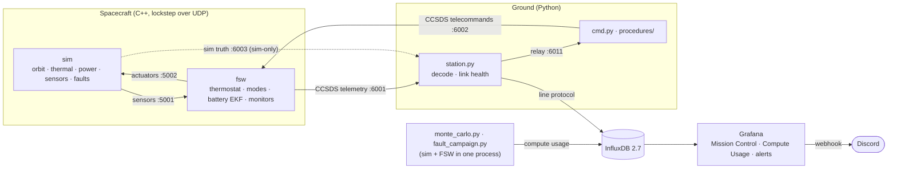

# Satellite Thermal & Power Digital Twin

[](https://github.com/devjamescollier/Satellite_Thermal_and_Power_Simulation/actions/workflows/ci.yml)
[](LICENSE)


Software-in-the-loop digital twin of a small LEO satellite's thermal and electrical power systems. A C++ spacecraft simulator and separate C++ flight software run in lockstep over UDP, and the flight software estimates battery state with an iterated Extended Kalman Filter. A Python ground station streams CCSDS telemetry into InfluxDB, and Grafana mission-control dashboards and alerts sit on top. Every tunable constant lives in one header, and the dashboards, alert rules and limit tables are generated from it.

Designed for spacecraft-operations and flight-software development, with fault injection, scripted procedures, Monte Carlo validation, and a one-command Docker stack.

## Table of Contents
- [Mission Control](#mission-control)
- [Architecture](#architecture)
- [Estimator Validation](#estimator-validation)
- [Overview](#overview)
- [Specifications](#specifications)
- [Results](#results)
- [Software](#software)
- [Tech Stack](#tech-stack)
- [Verification Tools](#verification-tools)
- [Documentation](#documentation)
- [Repository Structure](#repository-structure)
- [Contact](#contact)
- [License](#license)

## Mission Control


## Architecture


## Estimator Validation
| SOC Error | NEES |
| :---: | :---: |
|  |  |
| **NIS** | **Eclipse-Exit Prediction Error** |
|  |  |

## Overview

The system is three programs and a monitoring stack: a simulator, flight software and a ground station, with InfluxDB and Grafana. Details are in the [design notes](docs/design.md).

| Section                  | Description                                                                                                                                                                                        |
| ------------------------ | -------------------------------------------------------------------------------------------------------------------------------------------------------------------------------------------------- |
| **Spacecraft Simulator** | A C++ model of a 500 km LEO orbit, a five-node RK4 thermal network, a sun-tracking solar array and a 1-RC Li-ion battery, coupled step by step with an energy ledger, plus four injectable faults. |
| **Flight Software**      | A separate C++ process in 1 Hz lockstep with the simulator over UDP: battery heater thermostat, NOMINAL / LOAD_SHED / SAFE mode manager, CCSDS telemetry, and ACK/NACK for every telecommand.      |
| **Battery Estimator**    | An iterated EKF on [SOC, V_rc, R0] with a NIS gate, an eclipse-exit SOC prediction, and battery and radiator degradation monitors.                                                                 |
| **Ground Station**       | A Python station that decodes CCSDS telemetry and sim truth into InfluxDB with link health, and relays packets to the command and procedure tools.                                                 |
| **Mission Control**      | Provisioned Grafana dashboards (Mission Control, Compute Usage) and nine alert rules sent to a Discord webhook, all generated from `common/params.hpp`.                                            |
| **Operations**           | Scripted procedures with pass/fail reports, a headless fault campaign with anomaly reports, a 50-run Monte Carlo, an operator runbook, Docker packaging and CI.                                    |

## Specifications

| Parameter               | Value                                                                                                    |
| ----------------------- | -------------------------------------------------------------------------------------------------------- |
| **Orbit**               | 500 km circular, cylindrical Earth shadow                                                                |
| **Orbital Period**      | 5668 s (94.5 min)                                                                                        |
| **Beta Angle**          | 30° (default, `--beta`); eclipse is 36% of each orbit                                                    |
| **Thermal Nodes**       | 5: solar array, structure, battery, avionics, radiator                                                   |
| **Integrator and Step** | RK4, 1 s                                                                                                 |
| **Solar Array**         | 0.12 m², sun-tracking, 28% efficient at 25 °C, −0.25%/K; 45–56 W in sunlight                             |
| **Battery**             | 4S2P Li-ion, 6.8 Ah, 1-RC equivalent circuit; R0 80 mΩ at 25 °C, ≈2.5× at 0 °C                           |
| **Loads**               | Avionics 8 W, payload 15 W, battery heater 5 W                                                           |
| **Heater Thermostat**   | On below 5 °C, off above 10 °C; setpoints commandable within 253.15–313.15 K                             |
| **Mode Thresholds**     | LOAD_SHED below 40% SOC (exit above 50%); SAFE below 25% SOC or on any red limit                         |
| **Sensors**             | Thermistors σ 0.1 K, 0.1 K resolution; voltage σ 10 mV; current σ 10 mA                                  |
| **Loop Rate**           | 1 Hz sim time, lockstep, 0.2 s actuator timeout                                                          |
| **Max Speed**           | ≈17,000 steps/s (0.34 s per orbit) at `--speed 0`; demos run at 60×                                      |
| **Telemetry Format**    | CCSDS Space Packets: 6-byte primary + 6-byte MET secondary header, big-endian                            |
| **APIDs**               | 0x10 housekeeping, 0x11 estimator, 0x12 events/acks, 0x20 sim truth (sim-only), 0x30 telecommands        |
| **Telecommands**        | NOOP, SET_MODE, PAYLOAD_ON, PAYLOAD_OFF, SET_HEATER_SETPOINTS                                            |
| **Estimator State**     | [SOC, V_rc, R0]; iterated EKF (5 Gauss-Newton steps); NIS gate 10.828 (χ², 1 dof, 99.9%)                 |
| **FSW Monitors**        | BATTERY_DEGRADED: R0 > 1.5× nominal for 600 s; RADIATOR_DEGRADED: orbit-mean radiator > 284.80 K + 2.5 K |
| **Ground Alerts**       | 9 Grafana rules (4 critical, 5 warning), evaluated every 10 s                                            |
| **UDP Ports**           | 5001 sensors, 5002 actuators, 6001 telemetry, 6002 telecommands, 6003 sim truth, 6011 relay              |

## Results

Battery estimator, 50 runs × 10 orbits, each with its own sensor noise and an initial SOC error drawn uniformly from ±15% ([full results](docs/results/README.md)):

| Metric                                 | Value                                                                                                          |
| -------------------------------------- | -------------------------------------------------------------------------------------------------------------- |
| **RMS SOC Error (after orbit 1)**      | 0.034% SOC                                                                                                     |
| **RMS SOC Error (all steps)**          | 0.097% SOC                                                                                                     |
| **Max SOC Error (after orbit 1)**      | 0.225% SOC                                                                                                     |
| **NIS Inside 95% Bounds**              | 92.3% of steps                                                                                                 |
| **NEES Inside 95% Bounds**             | 27.3% of steps (28.8% after orbit 1); inconsistent, see [design notes](docs/design.md#battery-state-estimator) |
| **Mean Eclipse-Exit Prediction Error** | +0.140% SOC (always slightly optimistic)                                                                       |

Fault campaign: each fault injected at MET 6000 s into a 12-orbit headless run and checked against the same alert rules Grafana runs ([anomaly reports](docs/anomalies/README.md)):

| Fault                                | Detected By                            | Time to Detection        | Flight-Software Response                                                      |
| ------------------------------------ | -------------------------------------- | ------------------------ | ----------------------------------------------------------------------------- |
| **None (baseline)**                  | No alerts in 12 orbits                 | —                        | —                                                                             |
| **Degraded Cell** (R0 × 2)           | BATTERY_DEGRADED event, R0-ratio alert | 0.21 orbits (1200 s MET) | BATTERY_DEGRADED (R0 at 1.9× nominal) 605 s after the fault                   |
| **Stuck-On Heater**                  | Eclipse power-balance alert (+5.0 W)   | 0.53 orbits (3000 s MET) | None; keeps commanding the heater off                                         |
| **Biased Battery Thermistor** (+8 K) | R0-ratio alert                         | 0.53 orbits (3000 s MET) | None                                                                          |
| **Radiator Degradation** (ε −40%)    | RADIATOR_DEGRADED event                | 1.27 orbits (7200 s MET) | RADIATOR_DEGRADED (orbit mean +3.3 K above prediction) 7158 s after the fault |

Key verification numbers:

| Check                              | Result                                                         | Requirement |
| ---------------------------------- | -------------------------------------------------------------- | ----------- |
| **Energy Conservation** (5 orbits) | 0.00017% of absorbed energy                                    | < 0.5%      |
| **C++ vs NumPy EKF**               | 1.9×10⁻¹⁵ max state difference                                 | < 1×10⁻⁹    |
| **End-to-End Smoke** (2 orbits)    | 11337 of 11337 packets stored per measurement, 0 decode errors | ≥ 99%       |
| **Procedures**                     | Heater checkout and SAFE recovery: PASS                        | —           |

Results were verified using GoogleTest and pytest suites, a 50-run Monte Carlo, a headless fault campaign, and end-to-end runs checked through Grafana's API (`scripts/smoke.sh`, `tools/check_grafana.py`).

## Software

The simulator and flight software are written in C++17, the ground segment and tools in Python 3.11+.

### Running

1. Install Docker, CMake ≥ 3.20, a C++17 compiler and [uv](https://docs.astral.sh/uv/), then copy `.env.example` to `.env` and change every value.
2. Build: `cmake -S . -B build -DCMAKE_BUILD_TYPE=Release && cmake --build build -j` (Eigen and GoogleTest are fetched on first configure).
3. Test: `ctest --test-dir build --output-on-failure` (C++ tests, then pytest).
4. Run the demo: `scripts/run_demo.sh --fresh` (InfluxDB and Grafana in Docker; ground station, FSW and sim on the host; 1 orbit at 60×; `--fresh` clears old telemetry so the dashboard shows one clean run). To run the whole stack in containers instead, use `docker compose up -d`.
5. Open http://localhost:3000 in a browser and log in with the Grafana user name and password from `.env`.
6. Inject a fault: `scripts/run_demo.sh --orbits 3 --fault radiator_degradation@600` (faults: `degraded_cell`, `stuck_on_heater`, `biased_battery_thermistor`, `radiator_degradation`).

Commands, procedures and what to do for each alert are in the [operator runbook](docs/runbook.md).

## Tech Stack

| Simulation & FSW                                                                        | Ground Station                                                                            | Estimation                                                | Database                                                                                       | Dashboards                                                                                  | Containers                                                                        | Build                                                                          | Testing                                                                                                                                                                                  | CI                                                                                                         | Version Control                                                          | Repository Hosting                                                                |
| :-------------------------------------------------------------------------------------: | :---------------------------------------------------------------------------------------: | :-------------------------------------------------------: | :--------------------------------------------------------------------------------------------: | :-----------------------------------------------------------------------------------------: | :-------------------------------------------------------------------------------: | :----------------------------------------------------------------------------: | :--------------------------------------------------------------------------------------------------------------------------------------------------------------------------------------: | :--------------------------------------------------------------------------------------------------------: | :----------------------------------------------------------------------: | :-------------------------------------------------------------------------------: |
|  |  |  |  |  |  |  |   |  |  |  |

## Verification Tools

| Tool                                            | Version | Purpose                                                                             |
| ----------------------------------------------- | ------- | ----------------------------------------------------------------------------------- |
| **GoogleTest**                                  | 1.15.2  | C++ unit and integration tests: physics, faults, FSW, EKF, CCSDS                    |
| **pytest**                                      | 9.1.1   | Ground decoding, InfluxDB points, alert rules, station shutdown, EKF cross-check    |
| **ruff**                                        | 0.17.1  | Python lint                                                                         |
| **clang-format**                                | 22.1.8  | C++ formatting check (pinned in `uv.lock`)                                          |
| **`tools/monte_carlo.py`**                      | —       | 50-run × 10-orbit EKF validation, writes `docs/results/`                            |
| **`tools/fault_campaign.py`**                   | —       | Runs every fault headless against the alert rules, writes `docs/anomalies/`         |
| **`tools/ekf_trace` + `ground/ref/ekf_ref.py`** | —       | C++ EKF vs independent NumPy reference                                              |
| **`tools/check_grafana.py`**                    | —       | Runs every panel query and alert rule through Grafana's API                         |
| **`scripts/smoke.sh`**                          | —       | 2-orbit end-to-end run into InfluxDB, then `check_grafana.py`                       |
| **`ground/procedures/`**                        | —       | Heater checkout and SAFE recovery with pass/fail reports in `docs/reports/`         |
| **GitHub Actions**                              | —       | Build, ctest, pytest, ruff, clang-format, and x86 Docker image builds on every push |

## Documentation

Project documentation is in the [`docs`](docs/) directory:

- [`design.md`](docs/design.md) — Physics model, sim/FSW loop, estimator design, faults, ground segment, full test list, known simplifications
- [`icd.md`](docs/icd.md) — Every packet and field, byte by byte
- [`requirements.md`](docs/requirements.md) — Requirements and how each is verified
- [`runbook.md`](docs/runbook.md) — For operators: starting the stack, every dashboard panel, every alert
- [`limits.md`](docs/limits.md) — Temperature limits and alert rules (generated)
- [`anomalies/`](docs/anomalies/README.md) — Fault campaign results and one anomaly report per fault (generated)
- [`results/`](docs/results/README.md) — Monte Carlo results and plots (generated)
- [`reports/`](docs/reports/) — Latest procedure reports (generated)

## Repository Structure

```text
Satellite_Thermal_and_Power_Simulation
├── .github/workflows/ci.yml                        CI: build, tests, lint, format, Docker images
├── common                                          Headers shared by sim and FSW
│   ├── params.hpp                                  Every tunable constant (SI units, Kelvin, ports, limits)
│   ├── messages.hpp                                Sim <-> FSW bus structs and shared enums
│   ├── ccsds.hpp                                   CCSDS Space Packet encode/decode
│   ├── battery_model.hpp                           OCV curve and nominal R0(T), shared by sim and FSW
│   └── udp.hpp                                     Minimal loopback UDP socket
├── sim                                             Spacecraft simulator: library + thin main()
│   ├── orbit.*, thermal.*, power.*                 Orbit and eclipse, RK4 thermal network, array and battery
│   ├── spacecraft.*                                Couples the models, applies faults, keeps the energy ledger
│   ├── sensors.*                                   Noisy sensors, actuators, sim-truth packet
│   ├── main.cpp                                    Lockstep loop with FSW over UDP
│   └── Dockerfile                                  Rocky Linux 10 multi-stage image
├── fsw                                             Flight software: library + thin main()
│   ├── control.*                                   Thermostat, mode manager, eclipse predictor, degradation monitors
│   ├── ekf.*                                       Battery iterated EKF (Eigen)
│   ├── flight_software.*                           One control cycle: commands, control, telemetry
│   ├── main.cpp                                    UDP plumbing
│   └── Dockerfile                                  Rocky Linux 10 multi-stage image
├── ground                                          Python ground segment
│   ├── station.py                                  Telemetry and sim truth -> InfluxDB, link health, relay
│   ├── ccsds.py, points.py                         Packet decoding and InfluxDB line protocol
│   ├── alerts.py                                   Alert rules shared by Grafana and the fault campaign
│   ├── cmd.py, decode.py, downlink.py              Telecommands, telemetry printout, link
│   ├── influx.py, env.py, params.py                InfluxDB writer, settings, constants from params.hpp
│   ├── plot_run.py                                 Plots a sim CSV
│   ├── procedures                                  Operations procedures
│   │   ├── procedure.py                            Shared send / wait-for-ack / wait-for-condition helper
│   │   ├── heater_checkout.py                      Battery heater checkout
│   │   └── safe_mode_recovery.py                   SAFE to NOMINAL recovery
│   ├── ref/ekf_ref.py                              NumPy reference EKF
│   └── Dockerfile                                  Ground station image
├── tools                                           Analysis and generator tools
│   ├── mc_run.cpp, ekf_trace.cpp                   Headless sim + FSW run; EKF trace for the cross-check
│   ├── monte_carlo.py                              EKF Monte Carlo
│   ├── fault_campaign.py                           Fault campaign and anomaly reports
│   ├── jobs.py                                     Parallel jobs with wall time, CPU time and peak memory
│   ├── gen_grafana.py                              Generates dashboards, alert rules and docs/limits.md
│   ├── grafana_panels.py, grafana_dashboards.py    Panel helpers and the two dashboards
│   └── check_grafana.py                            Panel and alert-rule checks via Grafana's API
├── scripts                                         Run scripts
│   ├── run_local.sh                                FSW + sim
│   ├── run_demo.sh                                 InfluxDB and Grafana in Docker, the rest on the host
│   └── smoke.sh                                    2-orbit end-to-end check
├── grafana/provisioning                            Datasource, dashboards, alert rules, contact point, policy
├── tests                                           GoogleTest and pytest suites
├── docs                                            Design, interfaces, requirements, runbook, generated results
├── docker-compose.yml                              Whole stack: InfluxDB, Grafana, FSW, sim, station
├── CMakeLists.txt                                  C++ build (fetches Eigen and GoogleTest)
├── pyproject.toml, uv.lock                         Python dependencies (uv)
├── .env.example                                    Settings template; copy to .env (git-ignored)
├── LICENSE                                         MIT License
└── README.md                                       Project README
```

## Contact
- GitHub: [@devjamescollier](https://github.com/devjamescollier)
- Email: [jwcollie@usc.edu](mailto:jwcollie@usc.edu)

## License

Copyright © 2026 James Collier

This project is licensed under the MIT License. See [LICENSE](LICENSE).
