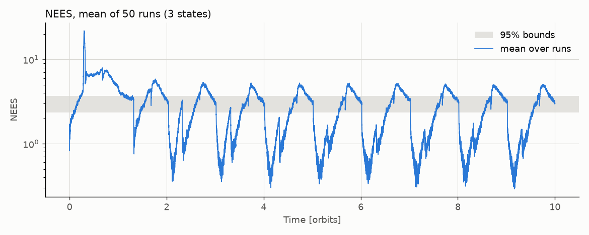
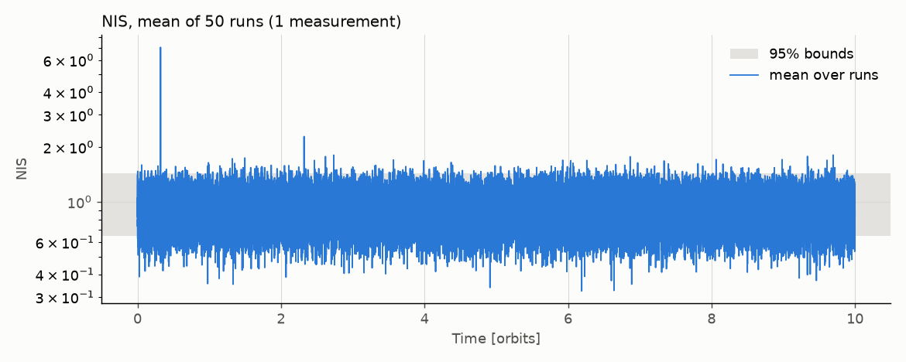
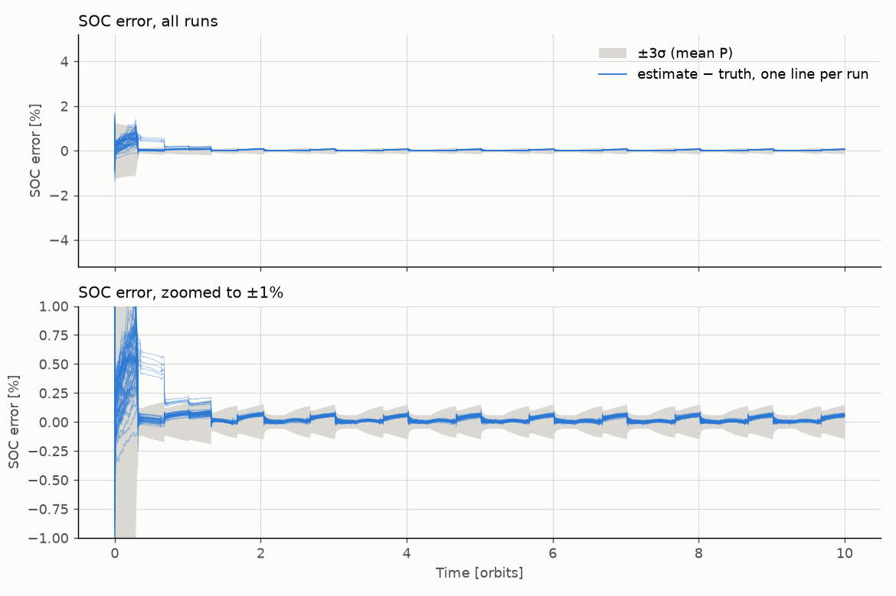
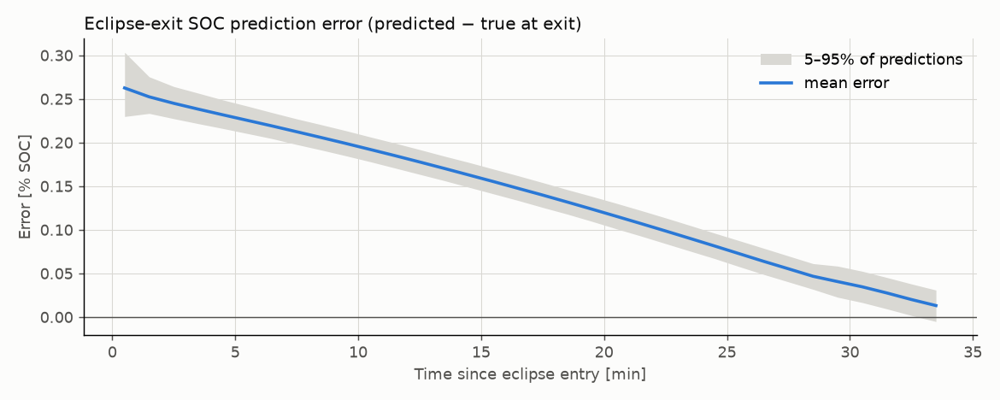

# EKF Monte Carlo results

Generated by `uv run python tools/monte_carlo.py`. Do not edit by hand.

50 runs × 10 orbits. Each run has its own sensor-noise seed and an initial
EKF SOC error drawn uniformly from ±15%. The sim and FSW run in one process at the
default 30° beta angle with default loads. Truth is taken from the battery at the start
of each step, which is the state that produced the measurement.

| Metric | Value |
|---|---|
| NEES inside 95% bounds (all steps) | 27.3% |
| NEES inside 95% bounds (after orbit 1) | 28.8% |
| NIS inside 95% bounds (all steps) | 92.3% |
| RMS SOC error (all steps) | 0.097% SOC |
| RMS SOC error (after orbit 1) | 0.034% SOC |
| Max SOC error (after orbit 1) | 0.225% SOC |
| Mean eclipse-exit prediction error | +0.140% SOC |
| Mean absolute prediction error | 0.140% SOC |

- NEES is averaged over runs at each step and compared with χ²(150)/50
  95% bounds [2.36, 3.72].
- NIS is averaged the same way and compared with χ²(50)/50
  bounds [0.65, 1.43].
- Prediction error covers all 912200 predictions made during eclipses after the
  first one (the first eclipse has no previous duration to use). Each prediction is
  compared with the true SOC at that eclipse's exit.

